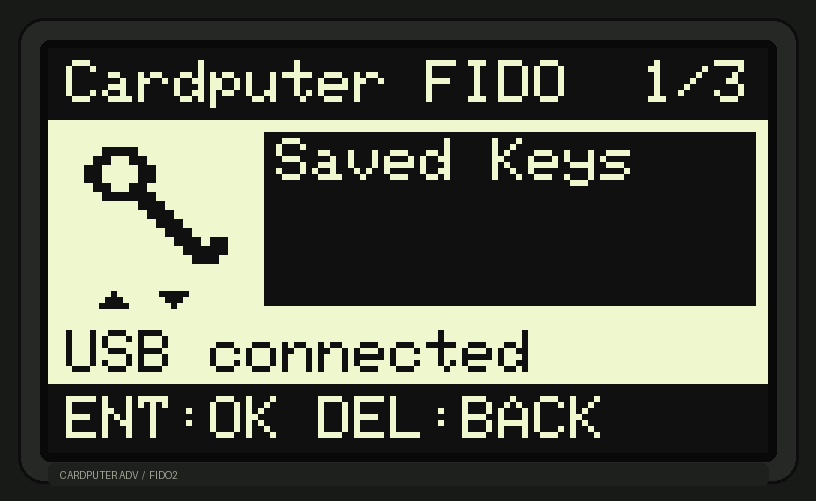

# Cardputer FIDO ADV

A simple vibe-coded project aimed at getting a quick and cheap FIDO2/WebAuthn
authenticator out of a Cardputer ADV, for low-importance sites and testing
FIDO2 projects. No ambitions, no guarantees and no real security.



## What it is

Cardputer FIDO ADV turns the Cardputer into a USB HID security key with a
small local menu, a physical confirmation button and persistent resident
credentials. The UI is rendered at the panel's native 240×135 resolution;
the image above is generated from the production LCD layout code.

- CTAP2/FIDO2 over USB HID, with CTAP1/U2F retained.
- `Saved Keys`, `Settings` and `Power Off` menus.
- `Enter` confirms; the physical `Del` key cancels.
- Resident credentials can be listed and deleted locally after a fresh
  confirmation.
- Volume, brightness and screen timeout are stored in NVS.
- Fail-closed key store: the firmware refuses to start if the required
  `fido_store` partition is missing, malformed or overlapping.

The main flows — MakeCredential, GetAssertion with signature verification,
discoverable credentials, Launcher installation and Power Off — have been
exercised on a development Cardputer ADV. This is still a **prototype**, not
a certified security key.

## Build

### Host tests

```sh
cmake -S tests/cardputer -B build/cardputer-host -G Ninja \
  -DCMAKE_BUILD_TYPE=Debug -DCARDPUTER_SANITIZERS=ON
cmake --build build/cardputer-host
ctest --test-dir build/cardputer-host --output-on-failure -R '^cardputer_'
```

### Firmware

Requires ESP-IDF v5.5.3 and the ESP32-S3 toolchain:

```sh
. "$HOME/esp/esp-idf-v5.5.3/export.sh"
bash scripts/cardputer/build.sh
python3 scripts/cardputer/check-build.py build/cardputer-adv
python3 scripts/cardputer/package.py --build build/cardputer-adv \
  --out dist/cardputer-adv
```

`build.sh` never flashes, erases or monitors a device.

### Install through Launcher

The package is app-only. A pre-existing `fido_store` partition
(type `0x40`, subtype `0x01`, size `0x102000`) is required; ordinary
Launcher app installation does not create it. Back up the full flash before
any partition operation and read
[`docs/INSTALL-LAUNCHER.md`](docs/INSTALL-LAUNCHER.md) first.

The partition CSV under `config/cardputer_adv/` is a build fixture, not a
partition table for a particular board. Do not flash it as-is.

## Security limitations

There is no real security here. This is a programmable microcontroller, not a
secure element.

- No Secure Boot, flash encryption, eFuse provisioning or secure element.
  Device secrets live in internal flash and can be read or replaced by an
  attacker with physical access; that can clone the authenticator.
- No startup PIN, local vault unlock or locked state. Anyone holding the
  powered device can confirm requests and manage local resident keys.
- A local `Enter` press is user presence, not user verification. Browser PIN
  and UV behavior is separate.
- CRC32 detects accidental corruption, not deliberate tampering. Logical
  credential deletion is not guaranteed forensic erasure.
- App updates are not signed or verified by this firmware. A malicious
  Launcher image, partition change or firmware replacement has full control.
- No backup/export. Losing or reformatting the device loses its credentials.
- The code has not been independently audited or FIDO-certified; side-channel
  and fault attacks are outside the current scope.

Use disposable credentials during testing and register a second independent
authenticator for accounts that matter.

## Documentation

- [`docs/BUILD.md`](docs/BUILD.md) — host, emulator and firmware builds
- [`docs/DESIGN.md`](docs/DESIGN.md) — architecture and storage decisions
- [`docs/INSTALL-LAUNCHER.md`](docs/INSTALL-LAUNCHER.md) — Launcher installation
- [`docs/HARDWARE-VALIDATION.md`](docs/HARDWARE-VALIDATION.md) — hardware checks

## Credits

This project is based on [Pico FIDO](https://github.com/polhenarejos/pico-fido)
by Pol Henarejos and uses the [Pico Keys SDK](https://github.com/polhenarejos/pico-keys-sdk).
Board support uses M5Unified/M5GFX and M5Stack keyboard sources; their notices
are retained in the source tree. This project is not affiliated with Pico FIDO
or M5Stack.

Development was assisted by **DeepSeek 4.1 Flash** and **GPT 6.1 Astra**.

## License

AGPL-3.0
